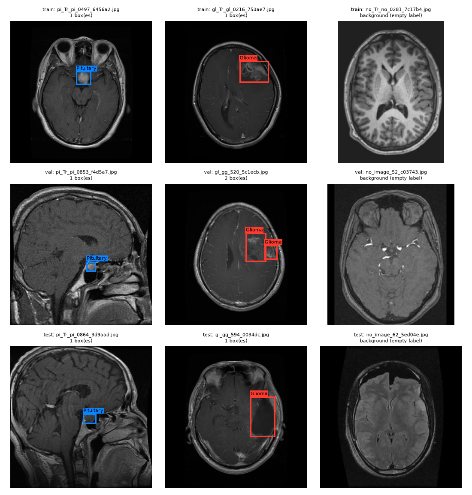
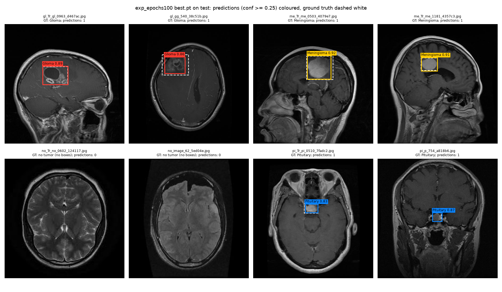
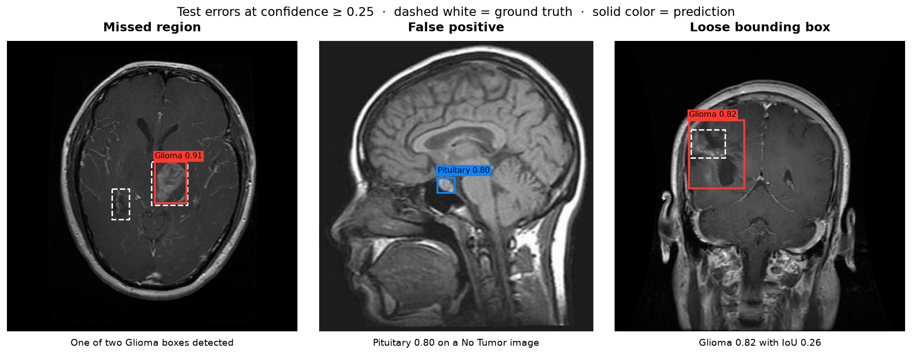

# Brain Tumor Detection from MRI

CSCI1409 bonus project. A fine-tuned YOLO11n detector predicts bounding boxes for Glioma, Meningioma, and Pituitary on 2D brain MRI slices. The checkpoint selected on validation reached **0.946 mAP@0.50** on the held-out test set.

[](https://colab.research.google.com/github/Kanaagaat/brain-tumor-object-detection/blob/main/train_colab.ipynb) · [Download the final checkpoint](https://raw.githubusercontent.com/Kanaagaat/brain-tumor-object-detection/main/runs/exp_epochs100/weights/best.pt)

## Dataset and split

The source is Ahmed Sorour's [MRI for Brain Tumor with Bounding Boxes, version 1](https://www.kaggle.com/datasets/ahmedsorour1/mri-for-brain-tumor-with-bounding-boxes), published on Kaggle under CC0. The source contains 5,249 images. The fixed subset uses 1,350 images. Each YOLO annotation row contains `class_id x_center y_center width height` with normalized coordinates.

The annotation audit checked missing and empty files, class mismatches, bounding-box coordinates, and conflicting duplicate labels. The cleaning pass excluded problematic tumor images and ambiguous groups. Images from the No Tumor folder have empty label files and serve as background examples. To limit leakage, the split keeps groups of likely related scans together using file hashes, perceptual hashes, and adjacent filename numbers. The split used seed 42. See the [annotation audit](reports/annotation_audit.csv), [split configuration](reports/split_v1_config.json), and [image manifest](reports/split_v1_manifest.csv).

| Class | Train images | Train boxes | Validation images | Validation boxes | Test images | Test boxes |
| --- | ---: | ---: | ---: | ---: | ---: | ---: |
| Glioma (0) | 245 | 283 | 53 | 58 | 52 | 59 |
| Meningioma (1) | 245 | 251 | 52 | 52 | 53 | 53 |
| Pituitary (2) | 245 | 259 | 52 | 57 | 53 | 55 |
| No Tumor (background) | 210 | 0 | 45 | 0 | 45 | 0 |
| **Total** | **945** | **793** | **202** | **167** | **203** | **167** |



## Run in Google Colab

1. Open [the training notebook](https://colab.research.google.com/github/Kanaagaat/brain-tumor-object-detection/blob/main/train_colab.ipynb) and select a T4 GPU for training.
2. Select **Runtime → Run all**. The notebook installs pinned dependencies, downloads the [Kaggle archive](https://www.kaggle.com/api/v1/datasets/download/ahmedsorour1/mri-for-brain-tumor-with-bounding-boxes?datasetVersionNumber=1), and rebuilds the exact subset from the repository manifest. A prepared `subset_v1.zip` at `/content/subset_v1.zip` is also supported.
3. The default `train` mode runs the three training configurations, compares validation results, evaluates the selected checkpoint on test, and displays predictions. For evaluation with the existing runs, set `mode = "saved"` in the settings cell and run all. It selects and downloads the saved checkpoint using the recorded validation results.
4. Download the ZIP from `/content/brain_tumor/runs/` in the Files panel. Set `save_to_drive = True` in the settings cell to persist results in your Google Drive.

The [analysis notebook](notebook.ipynb) records the original annotation audit, construction of the split, experiment comparison, and test error analysis. For local inference from a clone, use the checkpoint already stored in the repository.

```bash
python -m pip install ultralytics==8.4.190
yolo predict model=runs/exp_epochs100/weights/best.pt source=path/to/mri.jpg imgsz=512 conf=0.25 iou=0.7
```

## Training and validation

All runs fine-tuned the same COCO-pretrained [YOLO11n weights](https://github.com/ultralytics/assets/releases/download/v8.4.0/yolo11n.pt) with Ultralytics 8.4.190 on a Colab T4. Shared settings were image size 512, batch size 16, SGD, seed 42, and the fixed train and validation splits. The two experiments independently changed the epoch budget and the initial learning rate. Validation used a confidence floor of 0.001 and NMS IoU of 0.70.

| Run | Epochs | Initial LR | Best epoch | Precision | Recall | mAP@0.50 | mAP@0.50–0.95 | Train min |
| --- | ---: | ---: | ---: | ---: | ---: | ---: | ---: | ---: |
| [Baseline](runs/baseline_yolo11n_512/run_info.json) | 50 | 0.010 | 50 | 0.870 | 0.901 | 0.934 | 0.692 | 10.70 |
| [Longer training](runs/exp_epochs100/run_info.json) | 100 | 0.010 | 99 | 0.907 | 0.889 | 0.936 | **0.707** | 19.98 |
| [Lower learning rate](runs/exp_lr00.005/run_info.json) | 50 | 0.005 | 49 | 0.917 | 0.910 | **0.949** | 0.697 | 11.23 |

The lower learning-rate run tested whether more gradual updates would improve validation mAP. It gained 0.015 at IoU 0.50 and 0.005 when averaged over IoU 0.50–0.95. The 100-epoch run achieved the highest score across IoU 0.50–0.95, the selection criterion, and took about nine additional minutes. The epoch budget also affects the learning-rate schedule and when mosaic augmentation ends. Each setting was evaluated with one seed. The [baseline curves](runs/baseline_yolo11n_512/learning_curves.png), [100-epoch curves](runs/exp_epochs100/learning_curves.png), and [lower-LR curves](runs/exp_lr00.005/learning_curves.png) are saved alongside their training logs and `args.yaml` configs.

## Held-out test results

The selected [epoch-99 checkpoint](runs/exp_epochs100/weights/best.pt) was evaluated on 203 test images with 167 annotated boxes.

| Class | Precision | Recall | mAP@0.50 | mAP@0.50–0.95 |
| --- | ---: | ---: | ---: | ---: |
| Glioma | 0.910 | 0.678 | 0.859 | 0.611 |
| Meningioma | 0.981 | 1.000 | 0.995 | 0.880 |
| Pituitary | 0.929 | 0.964 | 0.983 | 0.696 |
| **All classes** | **0.940** | **0.881** | **0.946** | **0.729** |

Precision measures how many predictions match a reference class and box. Recall measures how many annotated boxes are matched. mAP@0.50 averages class AP with a box-match threshold of IoU 0.50. mAP@0.50–0.95 averages over ten match thresholds. Ultralytics used a confidence floor of 0.001 and NMS IoU 0.70. The reported precision and recall use the confidence that maximized mean F1 on the evaluation curve, approximately 0.758. See the [full metrics and settings](runs/exp_epochs100/test_eval/test_metrics.json).



## Error analysis and limitations

At confidence 0.25 with match IoU 0.50, the detector produced 155 true positives, 25 false positives, and 12 false negatives. All 12 unmatched boxes at that threshold were Glioma. The [per-image report](runs/exp_epochs100/test_eval/per_image_conf025.csv) supports the three cases below.



The [full case analysis](notebook.ipynb) discusses possible causes and follow-ups. One next experiment is to review the training annotations for small or ambiguously bounded Glioma regions and compare recall by box size on the same validation split.

The dataset lacks patient IDs, so the grouping heuristics cannot guarantee patient-level separation. Annotation inconsistencies and the small test set limit the interpretation of these results. This is an educational evaluation of 2D images.

## Acknowledgments

The project uses the [Ultralytics YOLO11 implementation](https://docs.ultralytics.com/models/yolo11/) and Ultralytics COCO-pretrained weights. OpenAI Codex assisted with troubleshooting, reproducibility checks, notebook and documentation updates, and preparation of the error-analysis figure. Anthropic's Claude assisted with the requirements check, the defense slides, and defense preparation notes.
